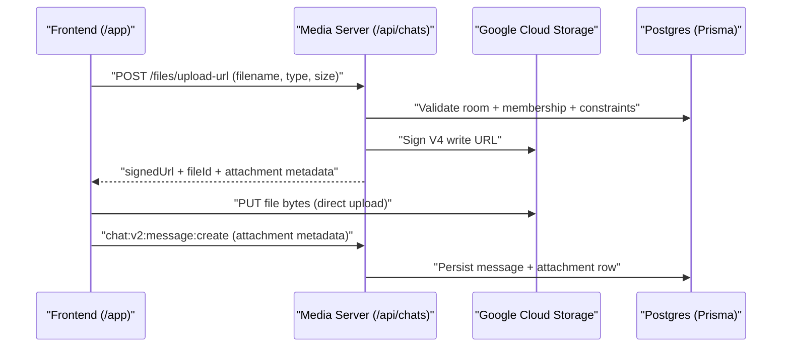

# Chat Files on GCS: Developer Architecture Guide

## Purpose and Scope
This document explains how chat file storage works after the GCS signed-URL rollout, why it was designed this way, and how to run it in both local development and production.

Scope covered:
- Upload, view, download, and delete flows for chat attachments.
- Frontend + backend integration contracts.
- Storage architecture decisions and security boundaries.
- Local dev setup and production rollout/deploy order.

Out of scope:
- Legacy `/api/chat/uploads/*` endpoints (removed in hard switch).
- Generic object storage abstractions not used by chat files.

## High-Level Design
The system uses **direct browser-to-GCS file transfer**:
1. Frontend requests a signed URL from backend.
2. Backend validates auth + chat membership + file constraints, then signs.
3. Frontend uploads/downloads directly against GCS.
4. Backend stores and authorizes attachment metadata only.

Why this design:
- Avoids routing file bytes through Express (lower CPU, memory, egress load).
- Keeps authorization centralized in service layer.
- Keeps storage SDK calls isolated in infrastructure layer.
- Supports scalable cleanup via soft-delete + purge worker.



## Repository Layout and Responsibilities

### Frontend (`/Users/AndrewPinon/projects/workdash`)
- `src/communication/chatV2/uploadService.ts`
  - Calls backend for signed URLs.
  - Uploads file bytes directly to signed URL.
  - Resolves preview/download URLs by `fileId`.
- `src/common/components/DeskMode/Composer.tsx`
  - Uses upload utility before sending message.
- `src/common/components/DeskMode/MessageList.tsx`
- `src/common/components/DeskMode/ThreadPanel.tsx`
  - Uses `fileId` to fetch preview/download URLs.

### Backend (`/Users/AndrewPinon/projects/workdash-media-server`)
- `src/config/gcs.config.ts`
  - Central env + storage constants + GCS client/bucket creation.
- `src/infrastructure/gcs.infrastructure.ts`
  - GCS SDK operations only (sign URLs, exists, delete).
  - No auth/business rules.
- `src/services/chat-file.service.ts`
  - Authorization, validation, object path generation, flow orchestration.
- `src/controllers/chat-file.controller.ts`
  - HTTP parsing + error mapping.
- `src/routes/chats.route.ts`
  - `/api/chats/...` endpoints for file operations.
- `src/repositories/chat/chat-attachment.repository.ts`
  - Attachment metadata lookups + soft/hard delete.
- `src/workers/chat-file-purge.worker.ts`
  - Deferred physical cleanup from GCS after retention window.

## Contract and Endpoint Surface

### Backend HTTP API
- `POST /api/chats/:chatId/files/upload-url`
- `GET /api/chats/files/:fileId/view-url`
- `GET /api/chats/files/:fileId/download-url`
- `DELETE /api/chats/files/:fileId`

### Frontend utility contract
- `uploadChatFile(chatId: string, file: File): Promise<{ fileId: string }>`
- `getChatFilePreviewUrl(fileId: string): Promise<string>`
- `downloadChatFile(fileId: string): Promise<void>`

## Data Model and Persistence
Prisma changes in backend:
- `ChatStorageProvider` enum includes `GCS`.
- `ChatAttachment.deletedAt` supports soft delete.
- `ChatAttachment.deletedAt` indexed for purge scans.

Soft-delete behavior:
- API delete marks `ChatAttachment.deletedAt`.
- Attachment is hidden from message payloads (`where: { deletedAt: null }`).
- Worker later deletes GCS object and then hard-deletes DB row.

Why soft-delete first:
- User-visible delete is immediate.
- Physical object cleanup is retried asynchronously.
- Reduces user-facing failures during transient storage outages.

## Layering and Patterns

### 1) Infrastructure isolation
`gcs.infrastructure.ts` only wraps SDK calls and throws typed storage errors.

Why:
- Keeps storage side effects and SDK specifics in one place.
- Makes service logic testable and simpler to reason about.

### 2) Service-layer authorization
`chat-file.service.ts` enforces:
- Upload/view/download: user must belong to room.
- Delete: uploader OR room OWNER/ADMIN.

Why:
- All business rules in one layer.
- Controllers stay thin.
- Easier to audit security behavior.

### 3) Typed error model
`chat-file.errors.ts` maps to HTTP semantics (`400/401/403/404/502/500`).

Why:
- Predictable API error contract.
- Cleaner controller logic and client handling.

### 4) Signed URL constraints
- Upload signed URL is V4 `write` with required `Content-Type`.
- Download signed URL is V4 `read` with `Content-Disposition: attachment`.
- View signed URL is V4 `read` with `Content-Disposition: inline`.

Why:
- Correct browser behavior for preview vs forced download.
- Content type is bound at signing time.

### 5) Deterministic object keys
Object path format:
- `chat/<roomId>/<userId>/<fileId>/<safeFilename>`

Why:
- Clear ownership and traceability.
- Safer filename handling.
- Stable keying for purge and audit.

## Validation Rules (Backend)
- Max size: `10MB` (`MAX_FILE_SIZE_BYTES`).
- Allowed content types:
  - `image/png`
  - `image/jpeg`
  - `image/webp`
  - `application/pdf`
  - `text/plain`
- File IDs and object path IDs use `uuid` v4.

## Local Development Setup

## 1) Prerequisites
- Backend repo and frontend repo checked out locally.
- Local Postgres + migrated schema.
- Local NATS/JetStream for media-server startup (required by chat stack).
- Existing GCS bucket + service account JSON key file.

## 2) Backend env (`/Users/AndrewPinon/projects/workdash-media-server/.env`)
Required:
```env
GCS_BUCKET_NAME=<bucket-name>
GCS_PROJECT_ID=<gcp-project-id>
GOOGLE_APPLICATION_CREDENTIALS=/absolute/path/to/service-account-key.json
```

Optional purge worker:
```env
CHAT_FILE_PURGE_INTERVAL_MS=300000
CHAT_FILE_PURGE_RETENTION_MS=604800000
CHAT_FILE_PURGE_BATCH_SIZE=100
```

## 3) Frontend env (`/Users/AndrewPinon/projects/workdash/.env.local`)
```env
NEXT_PUBLIC_SFU_SERVER_URL=http://localhost:4000
```

## 4) Bucket IAM (minimum permissions)
Service account used by backend signer needs:
- `storage.objects.create`
- `storage.objects.get`
- `storage.objects.delete`

Practical role shortcut:
- `Storage Object Admin` on the chat bucket.

## 5) Bucket CORS for browser direct upload/download
Example `cors.json`:
```json
[
  {
    "origin": ["http://localhost:8080", "https://workdash.site"],
    "method": ["GET", "PUT", "HEAD", "OPTIONS"],
    "responseHeader": ["Content-Type", "Content-Length", "ETag", "Content-Disposition"],
    "maxAgeSeconds": 3600
  }
]
```

Apply:
```bash
gcloud storage buckets update gs://<bucket-name> --cors-file=cors.json
```

## 6) Database migration
In media server repo:
```bash
npx prisma migrate deploy
```

For local dev databases not yet migrated:
```bash
npx prisma migrate dev
```

## 7) Run locally
Backend:
```bash
cd /Users/AndrewPinon/projects/workdash-media-server
npm run dev
```

Frontend:
```bash
cd /Users/AndrewPinon/projects/workdash
npm run dev
```

## 8) Local smoke test
1. Open `/app`, authenticate, and enter a room where user is member.
2. Upload an allowed file type (<10MB).
3. Confirm browser performs direct `PUT` to GCS signed URL.
4. Send message and verify attachment renders.
5. Confirm image/PDF preview works.
6. Confirm download opens signed `download-url`.
7. Delete file and verify it disappears from message payload/UI.

## Production Setup and Rollout

## 1) Secret/env configuration
Backend runtime must provide:
- `GCS_BUCKET_NAME`
- `GCS_PROJECT_ID`
- `GOOGLE_APPLICATION_CREDENTIALS` (or mounted equivalent path)
- Optional purge envs

Frontend runtime must provide:
- `NEXT_PUBLIC_SFU_SERVER_URL` pointing at deployed media server.

## 2) Deploy order (hard switch)
1. Apply DB migration in production:
   - `npx prisma migrate deploy`
2. Deploy backend.
3. Deploy frontend immediately after backend.

Why this order:
- Frontend now depends on `/api/chats/files/*` contract.
- Deploying frontend before backend can break uploads/downloads.

## 3) Runtime operations
- Monitor purge worker logs:
  - `[chat-file-purge] Worker started`
  - `[chat-file-purge] Batch finished`
  - `[chat-file-purge] Worker tick failed`
- Confirm GCS IAM/CORS drift has not removed required permissions.

## Troubleshooting

### 403 on signed upload `PUT`
Likely IAM issue. Verify signer has `storage.objects.create`.

### Signed upload URL generated but upload fails in browser
Check:
- CORS includes your frontend origin.
- Allowed methods include `PUT`.
- Allowed headers include `Content-Type`.

### Backend fails on startup with missing GCS env
`gcs.config.ts` validates env at module load; set required env vars in backend `.env`.

### `EADDRINUSE` on backend port 4000
Another process is already bound to port 4000; stop it before rerunning backend.

## Security Notes
- Never commit service account key JSON to source control.
- Keep signed URL expiries short (`15m upload`, `60m view/download`).
- Keep business auth in service layer, not controllers/infrastructure.
- Validate file type + size before issuing upload URL.

